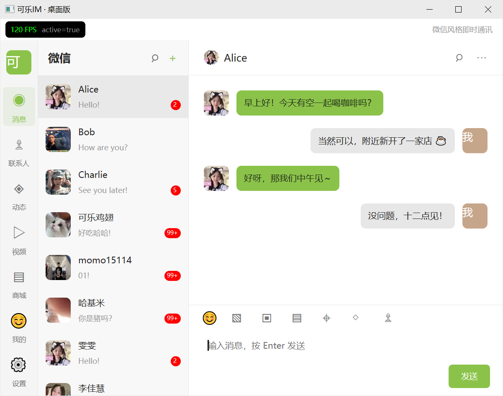
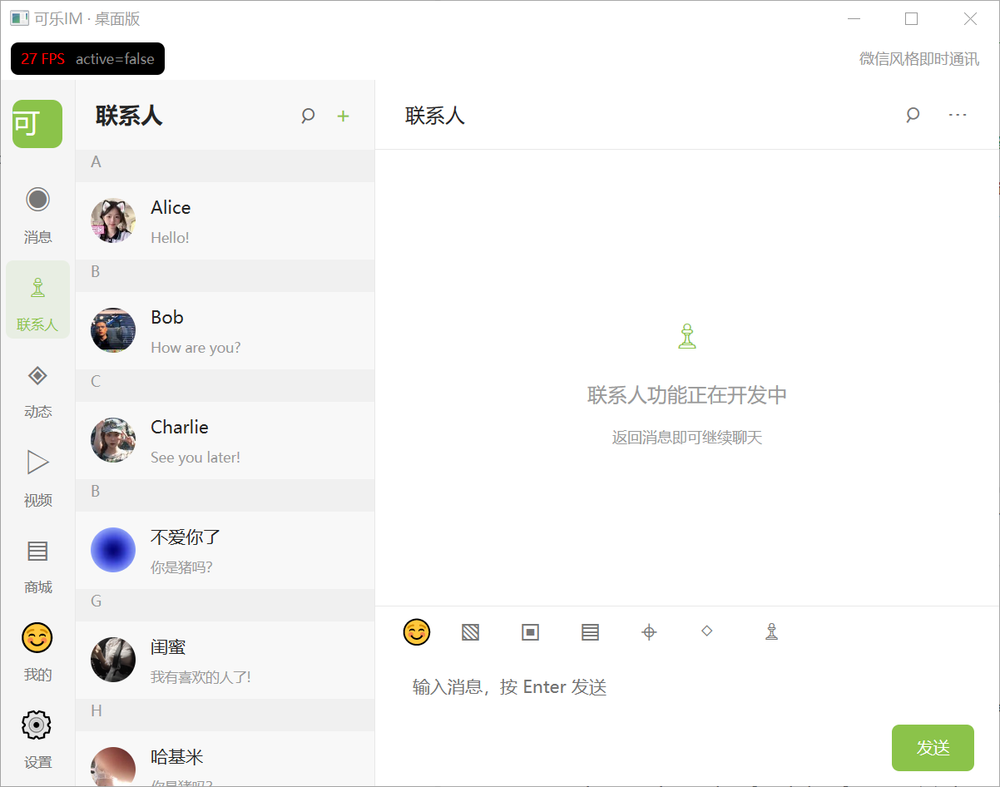

# 可乐 IM 桌面客户端

基于 Rust 与 [GPUI](https://www.gpui.rs/)（`gpui-kit` 0.7.3）构建的 Windows 桌面即时通讯客户端，并配套一套可独立编译的 Rust 基础 SDK（`cola_infra`），供桌面端与未来的 Android 客户端复用。

> 版本：`0.1.0` · 更新日期：2026-10-16

---

## 目录

- [核心特性](#核心特性)
- [技术栈](#技术栈)
- [项目结构](#项目结构)
- [快速开始](#快速开始)
- [SDK 说明](#sdk-说明)
- [截图](#截图)
- [文档](#文档)
- [许可证](#许可证)

---

## 核心特性

**桌面客户端（`client/`）**
- 基于 GPUI 的原生渲染界面，会话列表、消息气泡、通讯录等核心视图
- 附件消息：照片 / 视频 / 文件，支持缩略图与系统默认程序打开
- 会话切换时保留滚动位置，新消息 300ms 平滑滚动到底部

**基础 SDK（`crates/cola_infra/`）**
- 接入点（endpoint）探测与 Global Gateway 兜底刷新
- 基于 SQLite 的本地持久化，版本化迁移（`PRAGMA user_version`）
- 按应用（`application_id`）与账号（`account_id`）隔离的数据模型
- 对外提供 Rust 进程内接口，以及 C ABI（`extern "C"`）导出

---

## 技术栈

| 类别 | 选型 |
| --- | --- |
| 语言 | Rust（edition 2024） |
| 界面 | GPUI · `gpui-kit` 0.7.3 |
| 本地存储 | SQLite（`rusqlite`，bundled） |
| HTTP | `ureq`（同步） |
| 构建 | Cargo 工作区（virtual manifest） |
| 目标平台 | Windows（桌面）；Android（SDK，规划中） |

---

## 项目结构

```text
cola-im-desktop-client/
├── Cargo.toml              # 工作区根（virtual manifest）
├── .env                    # 运行期配置（如 FPS_DISPLAY_MODE）
├── assets/                 # README 截图
├── client/                 # 桌面客户端（二进制包）
├── crates/
│   ├── cola_infra/         # 基础 SDK：网络 / 存储 / FFI / 接口
│   ├── cola_data/          # 数据模型
│   ├── cola_auth/          # 认证（占位，尚未实现）
│   └── cola_video/         # 短视频（占位，尚未实现）
├── AGENTS.md               # 编码规范
└── DEVELOPMENT.md          # 开发文档
```

---

## 快速开始

**环境要求**：Windows，已安装 Rust 工具链（支持 edition 2024）。

```powershell
# 推荐：release 构建运行（帧率与流畅度请以 release 为准）
cargo run --release -p client

# 仅编译 / 测试
cargo build -p client
cargo test -p client
cargo test -p cola_infra
```

> 工作区只有一个二进制包，因此也可直接执行 `cargo run --release`，或 `cargo run --release --bin cola-im-desktop-client`。
> 首次 release 构建耗时较长（约 15 分钟），之后为增量编译。

**运行时配置**：项目根目录 `.env`，修改后重启生效。

```ini
# 1 = 显示左上角实时帧率表，0 = 关闭
FPS_DISPLAY_MODE = 1
```

---

## SDK 说明

`cola_infra` 可独立编译，目前已提供：

- **Rust 进程内调用**：`ui_api::AuthApi`（发送验证码、读取最近一次验证码）、`ui_api::ContactsApi`、`ui_api::MessagesApi`
- **C ABI 导出**：如 `cola_auth_send_captcha`、`cola_client_*`、`cola_string_free`，返回的字符串需通过 `cola_string_free` 释放

以下能力**尚在规划中，尚未完成**：

- 输出 Android 可用的 `.so` / 静态库产物（`cargo ndk` 交叉编译）
- 生成 C 头文件（cbindgen）与 JNI / UniFFI 绑定（Kotlin / Swift）
- 将 `ColaClient` 的数据切换为按账号分库的 SQLite 存储

---

## 截图

<p align="center">
  
</p>

<p align="center">
  
</p>

<p align="center">
  
</p>

---

## 文档

- [DEVELOPMENT.md](DEVELOPMENT.md)：开发环境、目录说明、性能调查、界面实现细节
- [AGENTS.md](AGENTS.md)：项目编码规范

---

## 许可证

待定。
